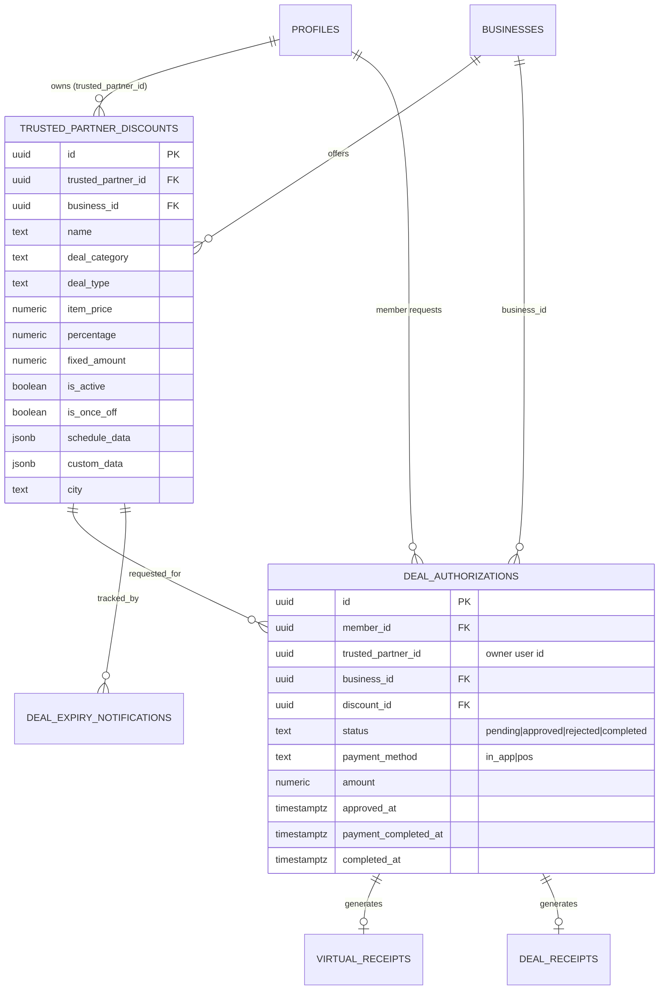
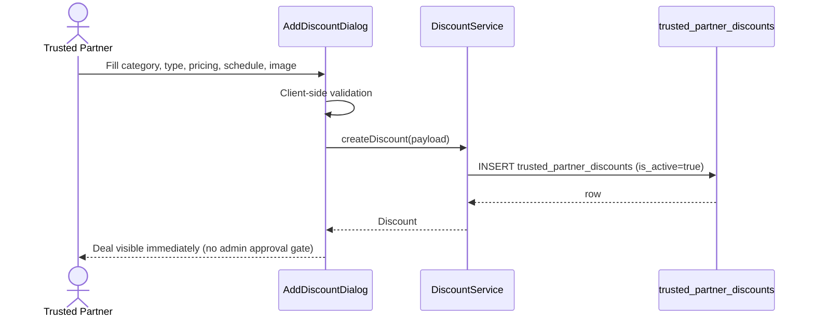
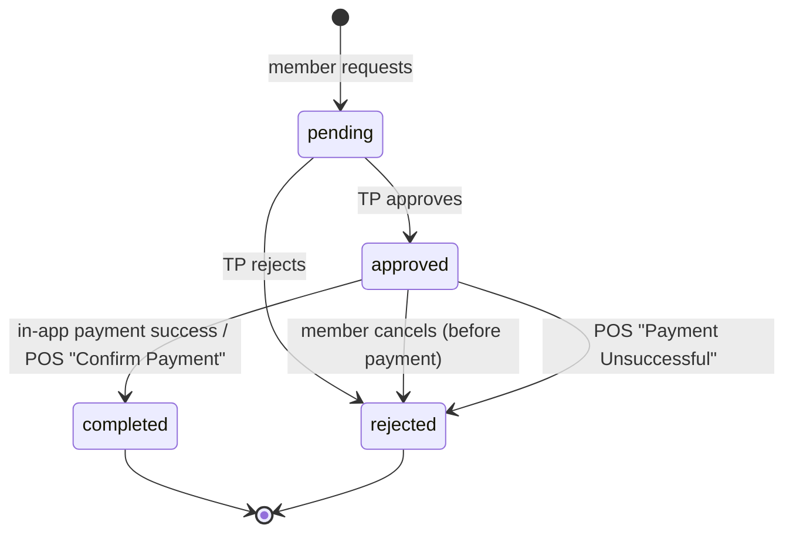
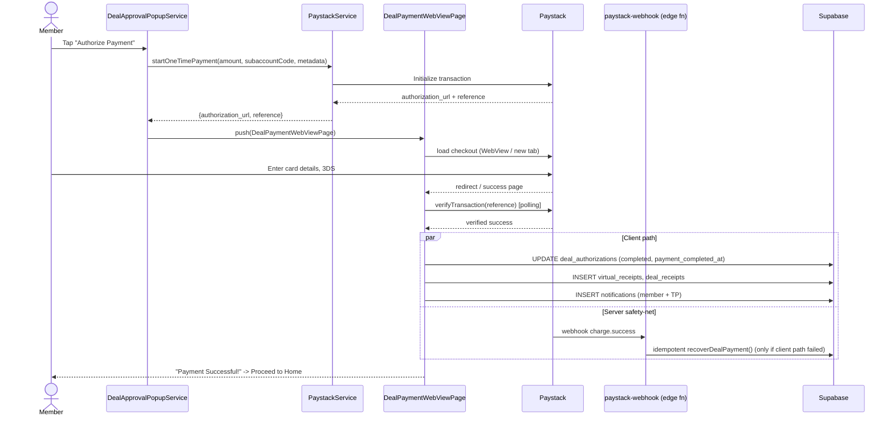
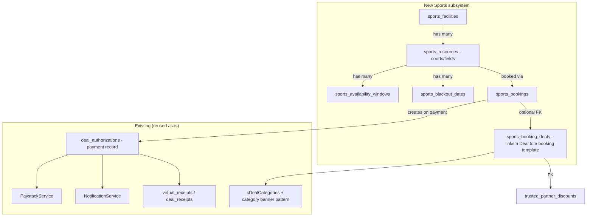

# Local Lekker — Sports Category Architecture Analysis
**Prepared for:** Sports category / booking-system feasibility & design
**Scope:** Full audit of deal system, deal-request system, TP structure, category architecture, booking-related code, payment flow, notification system, and user journeys — followed by a Sports category recommendation.

> All findings below are sourced directly from this repository. File paths are relative to the repo root (`c:\Users\clyde\Local Lekker\local_lekker\local_lekker`) unless stated otherwise.

---

## 1. DEAL SYSTEM

### 1.1 Core model — `Discount`
File: [lib/models/discount.dart](lib/models/discount.dart)

```dart
class Discount {
  final String id;
  final String trustedPartnerId;      // owner user id (auth.users.id)
  final String name;
  final String description;
  final String itemName;
  final double itemPrice;
  final double percentage;
  final double? fixedAmount;
  final String dealType;              // standard | bill_discount | once_off | weight | buy_get | percent_item | free_delivery
  final Map<String, dynamic>? customData;
  final bool requiresManualPrice;
  final bool isActive;
  final bool isWeightBased;
  final bool isBillDiscount;
  final bool isOnceOff;
  final Map<String, dynamic>? billDiscountData;
  final String? imageUrl;
  final Map<String, dynamic>? scheduleData;  // date range / day-of-week visibility window
  final String dealCategory;          // e.g. 'Food and Drink', 'Fresh & Local', 'Local Sips', 'Other'
  final bool offersDelivery;
  final String? city;
  final DateTime createdAt;
  final DateTime updatedAt;
}
```

Pricing logic (`dealPrice`, `savings`, `discountDisplay`) is type-aware — 6 deal "shapes" share one table via `deal_type` + `custom_data`/`bill_discount_data` JSON payloads rather than separate tables.

### 1.2 Database schema

**`trusted_partner_discounts`** (canonical deal table). Base schema in [supabase/migrations/20251013223100_deploy_comprehensive_schema.sql](supabase/migrations/20251013223100_deploy_comprehensive_schema.sql) (L200‑225), extended by many root-level `add_*.sql` migrations:

| Column | Source | Purpose |
|---|---|---|
| `id, trusted_partner_id, business_id, name, description, item_name, item_price, percentage, fixed_amount, is_active, created_at, updated_at` | comprehensive schema | base deal |
| `deal_category` (TEXT, NOT NULL, default `'Other'`) | [add_deal_category_column.sql](add_deal_category_column.sql) | category filter, indexed |
| `deal_type, custom_data (JSONB), requires_manual_price` | [add_new_deal_types.sql](add_new_deal_types.sql) | buy‑get / percent‑item support |
| `is_once_off` | [add_once_off_deal_flag.sql](add_once_off_deal_flag.sql) | single-redemption deals |
| `is_weight_based, is_bill_discount, bill_discount_data` | various | weight & bill-discount deal types |
| `image_url` | deal image work | deal photo |
| `schedule_data` (JSONB) | [add_schedule_data_to_discounts.sql](add_schedule_data_to_discounts.sql) | **date-range / day-of-week visibility window** (NOT a booking system — see §5) |
| `schedule_type, schedule_days, schedule_start_date, schedule_end_date, schedule_start_time, schedule_end_time` | [add_deal_schedule_columns.sql](add_deal_schedule_columns.sql) | legacy/parallel schedule columns + `is_deal_active_now()` SQL function (mostly superseded by client-side `schedule_data` JSON + `DealSchedule.isAvailableNow()`) |
| `offers_delivery` | Fresh Produce work | per-deal delivery flag |
| `city` | city filtering | deal locality |

**`deal_authorizations`** (redemption/purchase request) — see §2 for full schema.

**`deal_expiry_notifications`**, functions `get_deal_end_date()`, `expire_overdue_deals()`, views `tp_deals_expiring_tomorrow` / `tp_deals_expired_today` — [add_deal_expiry_management.sql](add_deal_expiry_management.sql).

### 1.3 Deal creation flow (TP / Admin)
UI: [lib/features/auth/discount_management_page.dart](lib/features/auth/discount_management_page.dart)
- `AddDiscountDialog` / `EditDiscountDialog` — a single form with a `DiscountType` enum (`percentage, fixedAmount, onceOff, weight, billDiscount, buyGet, percentItem, freeDelivery`) driving conditional fields.
- Fields collected: category (`kDealCategories` dropdown, locked for Fresh&Local/Local Sips partners), once-off flag, delivery flag, type-specific pricing, image upload (to `business-bills/deal_images/{ownerId}/...`), `DealScheduleWidget` (date range OR day-of-week).
- On submit, builds a `result` map → passed to `DiscountService.createDiscount()` / `updateDiscount()` in [lib/services/discount_service.dart](lib/services/discount_service.dart) (insert/update into `trusted_partner_discounts`).
- Admin variant: [lib/features/admin/admin_trusted_partner_profile_page.dart](lib/features/admin/admin_trusted_partner_profile_page.dart) `_addDealForPartner()` — admins can create deals on behalf of a TP only if `businesses.allow_admin_deal_creation = true`.

### 1.4 Validation rules (client-side, in `AddDiscountDialog`/`EditDiscountDialog`)
- Percentage 1–100; resulting deal price ≥ R5.00 (Paystack minimum).
- Fixed/once-off: deal price ≥ R5.00 AND < item price.
- Weight: deal price/kg < normal price/kg.
- Category required (dropdown validator).
- Bill discount: percentage 1–100 OR fixed amount > 0; exclusions list optional.

### 1.5 Deal status lifecycle
The **deal** itself has only `is_active` (boolean) — no formal approval workflow for deal *publishing* (any TP/admin can activate a deal instantly; there is no admin-approval gate on deal creation). What *is* approved is each member's **redemption request** (`deal_authorizations`, see §2).
- `is_active = true/false` toggle (edit dialog) — "publishing" is simply flipping this flag.
- Availability at display time is derived (not stored) via `DealSchedule.isAvailableNow()` (date range / day-of-week) — [lib/models/deal_schedule.dart](lib/models/deal_schedule.dart).
- Expiration: `schedule_data.end_date` (or legacy `schedule_end_date`) drives the `scheduled-deal-expiry-worker` (see next).

### 1.6 Scheduled jobs related to deals
Edge function: [supabase/functions/scheduled-deal-expiry-worker/index.ts](supabase/functions/scheduled-deal-expiry-worker/index.ts), intended to run daily via `pg_cron` (commented-out cron block in [add_deal_expiry_management.sql](add_deal_expiry_management.sql)):
1. Emails TP + admin for deals expiring tomorrow (`tp_deals_expiring_tomorrow` view).
2. Emails + auto-deactivates (`expire_overdue_deals()` RPC) deals whose `end_date` has passed (`tp_deals_expired_today` view).
3. Idempotent via `deal_expiry_notifications` unique constraint on `(deal_id, notification_type, recipient_role)`.

### 1.7 Deal inventory handling
**No inventory/stock-count concept exists.** The closest thing is `is_once_off` (per-member single redemption, enforced in `DealAuthorizationService.requestDealAuthorization()` by querying existing `deal_authorizations` for that member+discount). There is no "N slots available" or capacity counter anywhere in the deal system.

### 1.8 Deal redemption process
1. Member taps "Request" on `deal_selection_page.dart` → opens `DealAuthorizationRequestPage` ([lib/features/auth/deal_authorization_request_page.dart](lib/features/auth/deal_authorization_request_page.dart)) or, for bill discounts, `BillDiscountDialog`.
2. `DealAuthorizationService.requestDealAuthorization()` ([lib/services/deal_authorization_service.dart](lib/services/deal_authorization_service.dart)):
   - Checks active subscription OR `is_tp_member` bypass.
   - Fetches discount, validates once-off uniqueness.
   - Inserts `deal_authorizations` row (`status='pending'`) via `DiscountService.createDealAuthorization()`.
   - Sends push notification (`NotificationService.notifyTrustedPartnerOfDealRequest`) + email (`send-deal-request-email` edge fn).
3. TP approves/rejects via `DealAuthorizationDashboard` ([lib/features/auth/deal_authorization_dashboard.dart](lib/features/auth/deal_authorization_dashboard.dart)) → `approveDealAuthorization()`/`rejectDealAuthorization()` → status `approved`/`rejected`, notification + `send-deal-approval-email`.
4. Member pays (§6) → status `completed`, `payment_completed_at`/`completed_at` set, receipts generated (`virtual_receipts`, `deal_receipts`).

### 1.9 Deal expiration handling
See §1.6. UI-level: `DealSchedule.isAvailableNow()` hides expired/out-of-window deals from member browse lists client-side; the cron worker deactivates them server-side.

### 1.10 API endpoints / services involved
No custom REST API — everything is Supabase PostgREST + RPC + Edge Functions:
- Tables via PostgREST: `trusted_partner_discounts`, `deal_authorizations`, `virtual_receipts`, `deal_receipts`, `notifications`.
- RPCs: `get_next_receipt_number`, `is_deal_active_now`, `expire_overdue_deals`.
- Edge Functions: `send-deal-request-email`, `send-deal-approval-email`, `send-member-deal-request-confirmation-email`, `scheduled-deal-expiry-worker`, `send-payment-success-email`, `send-member-payment-success-email`.
- Dart services: `DiscountService`, `DealAuthorizationService`, `NotificationService`, `PaystackService`.

### 1.11 UI screens involved
| Screen | File | Role |
|---|---|---|
| Discount Management (TP/Admin) | `lib/features/auth/discount_management_page.dart` | create/edit/delete deals |
| Deal Selection / Browse Deals (Member) | `lib/features/auth/deal_selection_page.dart` | browse, filter, request |
| Trusted Partner Shop (single-partner deal list) | `lib/features/auth/trusted_partner_shop_page.dart` | per-partner deal list |
| Deal Authorization Request | `lib/features/auth/deal_authorization_request_page.dart` | quantity, manual price, payment method choice |
| Bill Discount Dialog | inside `deal_selection_page.dart` | bill-amount + exclusions calculator |
| Deal Authorization Dashboard (TP) | `lib/features/auth/deal_authorization_dashboard.dart` | approve/reject/receipts (Pending/Approved/Receipts tabs) |
| Admin Trusted Partner Profile | `lib/features/admin/admin_trusted_partner_profile_page.dart` | admin deal creation for a TP |
| Pending Payments (Member) | `lib/features/payments/pending_payments_page.dart` | approved-but-unpaid deals |
| Deal Payment WebView | `lib/features/payments/deal_payment_webview_page.dart` | Paystack checkout for a deal |

### 1.12 Entity Relationship Diagram (Deal system)



### 1.13 Sequence diagram — Deal creation



---

## 2. DEAL REQUEST SYSTEM

### 2.1 `deal_authorizations` full schema (merged across migrations)
Base: [supabase/migrations/20251010130000_create_deal_authorizations.sql](supabase/migrations/20251010130000_create_deal_authorizations.sql), [20251013223100_deploy_comprehensive_schema.sql](supabase/migrations/20251013223100_deploy_comprehensive_schema.sql). Extra columns: [add_missing_deal_auth_columns.sql](add_missing_deal_auth_columns.sql), [add_new_deal_types.sql](add_new_deal_types.sql).

```
id, member_id, trusted_partner_id, business_id, discount_id,
status TEXT DEFAULT 'pending' CHECK IN ('pending','approved','rejected','completed'),
authorization_type TEXT DEFAULT 'in_store' CHECK IN ('in_store','online'),
payment_method TEXT CHECK IN ('in_app','pos'),
amount, notes, rejection_reason,
member_entered_price, applied_discount_amount, deal_type, deal_snapshot (JSONB),
bill_data (JSONB, bill-discount breakdown),
created_at, updated_at, approved_at, payment_completed_at, completed_at
```
**Important quirk** (documented in repo memory `deal_authorization_tp_visibility_rls.md`): the app stores a **user id** in `trusted_partner_id` and the **business UUID** in `business_id` — inconsistent with the original migration's FK intent, fixed via RLS migration.

### 2.2 Lifecycle states
`pending → approved → completed` (happy path) or `pending → rejected`. Additional informal states surface via `payment_method`: `pending_payment` appears in webhook recovery logic ([paystack-webhook/index.ts](supabase/functions/paystack-webhook/index.ts) `recoverDealPayment`), and a member can `cancel` (sets status back to `rejected` with `rejection_reason='Cancelled by member'` in [lib/features/payments/pending_payments_page.dart](lib/features/payments/pending_payments_page.dart) `_cancelDeal()`), and a TP handling POS payment can mark `Payment Unsuccessful` (`cancelPOSPayment`) or `Confirm Payment` (`completePOSPayment`) in [deal_authorization_dashboard.dart](lib/features/auth/deal_authorization_dashboard.dart).



### 2.3 How a TP creates a deal request
Clarification: TPs do not "create deal requests" — **members** create deal requests against deals the TP already published. TPs create *deals* (§1.3). The phrase "deal request" in this codebase = a member's redemption request.

### 2.4 Approval workflow
`DealAuthorizationService.approveDealAuthorization({dealId, trustedPartnerId})` → `DiscountService.updateDealAuthorizationStatus(status:'approved')` → fetch deal, business contact → `NotificationService.notifyMemberOfDealApproval()` (push) → `send-deal-approval-email` edge fn (email with TP business name/contact/email — see repo memory `deal_request_email_member_details.md`).

### 2.5 Admin intervention points
- Admins can view all `deal_authorizations` (RLS policy "Admins can view all authorizations").
- Admins can create deals on a TP's behalf (`allow_admin_deal_creation` flag on `businesses`).
- No explicit admin approval step is required for a member's deal request — approval is entirely TP-controlled. Admin is a superuser/monitoring role, not a workflow gate.

### 2.6 Notifications (deal-request specific)
| Trigger | Channel | File |
|---|---|---|
| Member requests deal | Push (in-app `notifications` table + FCM) | `NotificationService.notifyTrustedPartnerOfDealRequest` |
| Member requests deal | Email to TP | `supabase/functions/send-deal-request-email/index.ts` |
| Member requests deal | Email confirmation to member | `supabase/functions/send-member-deal-request-confirmation-email/index.ts` |
| TP approves | Push + Email to member | `notifyMemberOfDealApproval` + `send-deal-approval-email` |
| Member cancels | Push + Email to TP | `notifyTrustedPartnerOfDealCancellation` + `send-deal-cancellation-email` |
| Payment completes | Push + Email (both parties) | `notifyTrustedPartnerOfPayment`/`notifyMemberOfPaymentSuccess` + `send-payment-success-email`/`send-member-payment-success-email` |

### 2.7 Frontend screens (deal request)
`deal_selection_page.dart` (browse+request entry), `deal_authorization_request_page.dart` (quantity/price/payment-method form), `BillDiscountDialog` (bill-discount variant), `deal_authorization_dashboard.dart` (TP: 3 tabs — Pending / Approved / Receipts), `pending_payments_page.dart` (member: approved-awaiting-payment list with Authorize/Cancel).

### 2.8 Data models
`DealAuthorization` — [lib/models/deal_authorization.dart](lib/models/deal_authorization.dart): `id, memberId, trustedPartnerId, discountId, status, authorizationType, paymentMethod, amount, memberEnteredPrice, appliedDiscountAmount, dealType, dealSnapshot, notes, rejectionReason, createdAt, updatedAt, approvedAt, paymentCompletedAt, completedAt, businessId`, plus joined `member (Profile)`, `trustedPartner`, `discount (Discount)`, `businessName`.

### 2.9 Validation rules
- Active subscription required unless `profiles.is_tp_member = true`.
- Once-off deal: block duplicate pending/approved/completed requests for same member+discount.
- `businessId`/`trustedPartnerId` must be non-null on the discount or the request throws (`"missing business information"`).
- Payment method must be explicitly chosen (`in_app` or `pos`) before submit.

---

## 3. TP STRUCTURE

### 3.1 What a TP is
A **Trusted Partner** = a business account. Roles: `member`, `trusted_partner`, `admin` (`memberships.role`, `profiles.role`). A TP row exists in `trusted_partners` (per-user metadata: key, status) and a separate `businesses` row (per-user, 1:1 via `owner_member_id`) holds the storefront profile (name, category, city, contact, socials, category-specific opt-ins).

### 3.2 TP onboarding
Two paths:
1. **Admin-created** (primary/live path): [lib/features/admin/admin_add_partner_screen.dart](lib/features/admin/admin_add_partner_screen.dart) → RPC `admin_create_trusted_partner` (creates `auth.users` + trigger creates `profiles`/`memberships`/`trusted_partners`) → then `admin_update_trusted_partner` RPC seeds the `businesses` row (name, category, Fresh Produce/Alcohol opt-ins). See [APPLY_ADMIN_PASSWORD_CREATION.sql](APPLY_ADMIN_PASSWORD_CREATION.sql) for the full RPC.
2. **Lead capture / self-interest**: `lib/features/auth/tp_interest_form_page.dart` inserts into `tp_inquiries` table ([add_tp_inquiries_table.sql](add_tp_inquiries_table.sql)) and calls edge fn `send-tp-inquiry-email` (emails admin + push to all admins); admin manually converts via Admin Add Partner screen. NOTE: `lib/features/auth/trusted_partner_signup_page.dart` is **dead code** (per repo memory `fresh_local_produce_category.md`).

### 3.3 TP approval process
There is no formal "pending review" gate for admin-created TPs — `businesses.verified = true` and `allow_admin_deal_creation = true` are set immediately on creation. What is gated:
- **TP member activation** (a member becoming a "TP member" via a 12-char `unique_key`) — see repo memory `tp_member_activation_flow.md` for the complete flow (`trusted_partners.unique_key` → `TpMembershipService.activateDirect()`).
- **Banking/subaccount verification** — separate admin-review flow for Paystack subaccounts (banking notifications, `subaccount_active`).

### 3.4 TP profile structure
`businesses` table columns discovered: `id, owner_member_id, name, category, city, address, logo_url, contact_number, contact_email, business_email, facebook_handle, instagram_handle, website_url, verified, allow_admin_deal_creation, sells_fresh_produce, produce_description, sells_alcohol, alcohol_description, liquor_license_verified(+_at,_by)`.
`trusted_partners` columns: `user_id, unique_key, key_used_by, tp_member_status, business_name, paystack_subaccount_id/code, paystack_recipient_code, created_at, updated_at`.

### 3.5 TP categories
**Two independent category concepts** (documented gotcha in repo memory `fresh_local_produce_category.md`):
1. `businesses.category` — the **business type** (e.g. "Restaurant", "Retail", "Health & Beauty", "Automotive", "Entertainment", "Professional Services", "Food & Beverage", "Other" — hardcoded list in `admin_add_partner_screen.dart` `_categories`). Purely descriptive; does not drive deal filtering.
2. `trusted_partner_discounts.deal_category` — the **deal category** (`kDealCategories` in [lib/core/constants/deal_categories.dart](lib/core/constants/deal_categories.dart)), which DOES drive member-facing filtering/search (§4).

### 3.6 TP permissions
- Full CRUD on own `businesses` row and own `trusted_partner_discounts` (RLS: `owner_member_id = auth.uid()`).
- View/approve/reject `deal_authorizations` where `business_id` belongs to them.
- `allow_admin_deal_creation` flag lets an admin also manage the TP's deals.
- No cross-TP visibility.

### 3.7 TP dashboard capabilities
[lib/features/auth/trusted_partner_home_page.dart](lib/features/auth/trusted_partner_home_page.dart) (2300+ lines) — Business view: QR scanner for member transactions, discount count summary, pending deal-request badge, unread chat badge, banking status, analytics widget/dashboard link, Business Profile nav, Deal management nav, Deal Authorization dashboard nav. Member view (toggle): mirrors `members_home_page.dart` for TP-members (Find Deals, Receipts, Partners, category banners).

### 3.8 Existing category implementation (pattern)
Established 3-step pattern from Fresh & Local / Local Sips (repo memory): (1) add `businesses.sells_X` + deal-side flag/column via SQL migration; (2) add category string to `kDealCategories` + `kXCategory` constant; (3) build a `_getCategoryPartners`/`_getCategorySummary` pair in `DiscountService` (generic `_getCategoryPartners({category, flagColumn, logLabel, city})` engine already exists and is reused), a member entry point (home page quick-action tile + banner), and a partner list page (`TrustedPartnerShopPage`).

---

## 4. CATEGORY ARCHITECTURE

### 4.1 How categories are stored
- **Deal category**: `trusted_partner_discounts.deal_category` (TEXT, indexed), canonical list `kDealCategories` in [lib/core/constants/deal_categories.dart](lib/core/constants/deal_categories.dart) (also exposes `kFreshLocalCategory = 'Fresh & Local'`, `kLocalSipsCategory = 'Local Sips'`).
- **Business category**: `businesses.category` (free-text/dropdown, separate concept, no FK/enum).
- **Category-specific business flags**: `businesses.sells_fresh_produce`, `businesses.sells_alcohol` (+ description columns) — boolean opt-ins layered on top of category string, used for partner-listing eligibility, NOT required for deal_category tagging.

### 4.2 How categories are displayed
- Deal creation dialogs: `DropdownButtonFormField<String>` over `kDealCategories` (`discount_management_page.dart`).
- Member browse: category dropdown filter in `deal_selection_page.dart` (`_applyFilters`, `_getFilteredDeals` on `deal['deal_category_filter']`).
- Home-page category entry banners: `CategoryEntryBanner`/`MemberCategoryBannerRow` ([lib/widgets/category_entry_banner.dart](lib/widgets/category_entry_banner.dart), [lib/widgets/member_category_banner_row.dart](lib/widgets/member_category_banner_row.dart)) — a shared banner shell (wide/compact) currently hosting Partners / Fresh & Local / Local Sips banners.
- Partner list pages per category: `lib/features/members/fresh_local_partners_page.dart`, `lib/features/members/local_sips_partners_page.dart` → both push into `TrustedPartnerShopPage`.

### 4.3 Does category drive business logic?
**Yes, substantially**, for the two "curated" categories (Fresh & Local, Local Sips):
- `DiscountService._getCategoryPartners()` / `_getCategorySummary()` (generic engine in [lib/services/discount_service.dart](lib/services/discount_service.dart)) qualifies a partner by (a) ≥1 active deal tagged with that `deal_category`, OR (b) the business opt-in flag + any active deal.
- Local Sips additionally gates behind an age-verification dialog ([lib/widgets/age_verification_dialog.dart](lib/widgets/age_verification_dialog.dart)) and a liquor-license-verification badge/warning (`LiquorLicenceWarning`).
- Fresh Produce additionally supports a per-deal `offers_delivery` flag and a dedicated `free_delivery` deal type.
- For **all other categories** (`Other`, `Food and Drink`, etc.) `deal_category` is purely a filter label with no further behavior.

### 4.4 Does category impact deal creation?
Yes — the category dropdown is a **required field** on every deal (`AddDiscountDialog`/`EditDiscountDialog` validators), and is **locked** (non-editable, forced value) when the dialog is opened in a curated-category context (`lockedDealCategory` param, used from the Fresh Produce/Local Sips partner-specific "Add Deal" entry points).

### 4.5 Does category impact search/filtering?
Yes — `deal_selection_page.dart` filters the member browse list by `deal_category_filter`; `trusted_partners_by_category_page.dart` filters partner lists by category; city + category can combine.

### 4.6 Related tables / services / UI components / extension points
- Tables: `trusted_partner_discounts.deal_category`, `businesses.category`, `businesses.sells_*` flags.
- Services: `DiscountService` (`_getCategoryPartners`, `_getCategorySummary`, `getFreshProducePartners`, `getLocalSipsPartners`, `getAvailableCities`).
- UI: `discount_management_page.dart` dropdowns, `deal_selection_page.dart` filters, `member_category_banner_row.dart` / `category_entry_banner.dart`, `fresh_local_partners_page.dart` / `local_sips_partners_page.dart`, `age_verification_dialog.dart` (as a template for category-specific gating), `LiquorLicenceWarning`.
- **Extension point for a NEW category** (e.g. Sports): add to `kDealCategories`; optionally a `businesses.offers_sports_facilities`-style flag if partner-level eligibility is needed beyond deal tagging; a dedicated member entry banner + partner list page; and — uniquely for Sports — a **new booking subsystem** (§5/§9) since none of the existing category machinery models capacity, time slots, or facilities.

---

## 5. BOOKING-RELATED EXISTING FUNCTIONALITY

**Explicit search performed for:** booking, reservation, schedule, calendar, appointment, availability, slot, timeslot, venue, court, field, facility, capacity — across `lib/`, `supabase/functions/`, and root SQL files, plus `pubspec.yaml` for calendar packages.

### 5.1 Result: **No real booking/reservation system exists.**
Everything found is **deal-visibility scheduling**, not slot/resource booking:

| Match | File | Assessment |
|---|---|---|
| `DealSchedule` model (`ScheduleType.dateRange`/`dayOfWeek`, `isAvailableNow()`) | [lib/models/deal_schedule.dart](lib/models/deal_schedule.dart) | Only decides whether a deal is *visible* to members right now. No time-slot granularity, no capacity, no per-user booking record. **Reusable as a "blackout window" building block only.** |
| `DealScheduleWidget` (date-range picker, day-of-week picker) | [lib/widgets/deal_schedule_widget.dart](lib/widgets/deal_schedule_widget.dart) | UI date/day pickers (CupertinoDatePicker wheels) — **reusable as generic date-range UI**, not slot picking. |
| `schedule_type/schedule_days/schedule_start_time/schedule_end_time` + `is_deal_active_now()` SQL fn | [add_deal_schedule_columns.sql](add_deal_schedule_columns.sql) | Same purpose as above, legacy parallel implementation. Not resource-aware. |
| `add_deal_expiry_management.sql` (`deal_expiry_notifications`, cron worker, expiry views) | root SQL + edge fn | Deal *lifecycle* expiry, not a booking calendar. |
| `pubspec.yaml` | — | **No calendar/date-picker package** beyond Flutter's built-in `showDatePicker`/`CupertinoDatePicker`. No `table_calendar`, no `syncfusion_flutter_calendar`, no booking SDK. |
| "venue", "court", "field", "capacity", "timeslot", "appointment" | grep across repo | **Zero matches** — confirmed no prototype or dead code for any of these concepts exists anywhere in the codebase. |
| `quantity` field on deal request | `deal_authorization_request_page.dart` | Generic numeric quantity (grams for weight-based deals, item count otherwise) — **not** a time-slot count, but conceptually the closest existing "how many units" input. |

### 5.2 Conclusion
Sports bookings (courts/fields/time slots/capacity/blackout dates) require **net-new tables, models, services, and UI** — the only reusable pieces are: (a) the `DealSchedule`/`DealScheduleWidget` date-range UI pattern (for blackout dates), (b) the deal_authorization → payment → receipt pipeline (for turning a booking into a paid transaction), and (c) the category architecture pattern (§4.6) for surfacing Sports as a member-facing entry point.

---

## 6. PAYMENT FLOW

### 6.1 Provider
**Paystack** only (no other gateway). Service: [lib/services/paystack_service.dart](lib/services/paystack_service.dart) (not fully dumped above but referenced throughout — `verifyTransaction`, `chargeSavedCard`, `startOneTimePayment`, `initializeSubscription`, `getSavedPaymentMethods`, subaccount helpers).

### 6.2 Two independent payment flows
1. **Subscription payment** (member signup/renewal) — [lib/features/payments/payments_feature.dart](lib/features/payments/payments_feature.dart) (`PaymentRequiredScreen`, `PaymentOptionsScreen`) → [lib/features/payments/paystack_webview_page.dart](lib/features/payments/paystack_webview_page.dart).
2. **Deal payment** (one-time, per redemption) — `DealApprovalPopupService.startPaymentForDeal()` ([lib/services/deal_approval_popup_service.dart](lib/services/deal_approval_popup_service.dart)) → saved-card charge OR [lib/features/payments/deal_payment_webview_page.dart](lib/features/payments/deal_payment_webview_page.dart) (new card via WebView).

### 6.3 Order/payment creation flow (deal purchase)
1. Deal approved → member notified (§2.6) → opens Pending Payments or approval popup.
2. `DealApprovalPopupService` checks saved cards; if present, prompts CVV via `_CardSelectionDialog`, calls `PaystackService.chargeSavedCard()`.
3. If no saved card / "use new card": `PaystackService.startOneTimePayment()` → Paystack `authorization_url` + `reference` → `DealPaymentWebViewPage` opens embedded WebView (mobile) or new tab (web via `openWebCheckout`).
4. Verification is **multi-layered** for resilience: (a) WebView navigation-delegate URL/content sniffing, (b) direct Paystack `verifyTransaction` API polling every 8s (`_startApiVerificationPolling`), (c) Supabase Realtime listener on `deal_authorizations` UPDATE, (d) manual "Already paid? Tap to verify" fallback button after 45s, (e) server-side `paystack-webhook` edge function safety net (`recoverDealPayment`).
5. On confirmed success: `deal_authorizations` updated `status='completed', payment_completed_at, completed_at`; `_autoGenerateReceipt()` inserts `virtual_receipts` + `deal_receipts` (sequential `get_next_receipt_number` RPC); push+email notifications to both parties; subaccount verification status logged.

### 6.4 Confirmation flow
Success screen with animated checkmark → "Proceed to Home" (deal) / auto-navigate after 5s. Webhook (`charge.success` event) is the authoritative server-side confirmation and idempotently backstops the client flow if the app is killed mid-payment.

### 6.5 Refund handling
**No refund functionality found** anywhere in the codebase (no `refund` keyword hits besides this analysis). Cancellations before payment simply set `deal_authorizations.status='rejected'`; there is no reversal of an already-completed payment.

### 6.6 Cancellations
- **Member-side pre-payment cancel**: `PendingPaymentsPage._cancelDeal()` → status `rejected` + `rejection_reason='Cancelled by member'` + notifies TP (push + `send-deal-cancellation-email`).
- **TP-side POS failure**: `DealApprovalPopupService`/`DealAuthorizationDashboard` "Payment Unsuccessful" → `cancelPOSPayment()`.
- **Webview payment cancel**: bottom-sheet "Cancel payment" choice in `DealPaymentWebViewPage`/`PaystackWebViewPage` navigates home without recording completion (explicitly does NOT self-report success, to avoid false completions).

### 6.7 TP payout mechanism
Paystack **subaccounts** (`trusted_partner_bank_accounts.subaccount_code`, `percentage_charge` default 90%) — split payment: platform keeps a cut, partner gets the rest via Paystack settlement. `transfer.failed`/`transfer.reversed` webhook events trigger admin + partner notifications ([paystack-webhook/index.ts](supabase/functions/paystack-webhook/index.ts) `handleTransferFailed`).

### 6.8 Sequence diagram — Deal purchase (in-app payment, new card)



---

## 7. NOTIFICATION SYSTEM

### 7.1 Channels present
| Channel | Present? | Detail |
|---|---|---|
| In-app (DB-backed) | ✅ | `notifications` table, `NotificationService` (CRUD, realtime stream), `NotificationModel` |
| Push (FCM) | ✅ | [supabase/functions/send-push-notification/index.ts](supabase/functions/send-push-notification/index.ts) (FCM HTTP v1, data-only messages), [lib/services/push_notification_service.dart](lib/services/push_notification_service.dart) (local display, channels, token mgmt), `profiles.fcm_token` column. Triggered by a DB webhook on `notifications` INSERT (currently **on hold** per [add_push_notification_webhook_trigger.sql](add_push_notification_webhook_trigger.sql) comments — in-app notifications work without it). |
| Email | ✅ | Many `send-*-email` Supabase Edge Functions (SMTP via Gmail, `denomailer`). |
| SMS / WhatsApp | ❌ | **No SMS or WhatsApp integration found** anywhere in the repo (grep for `sms`, `whatsapp`, `twilio` returns nothing beyond this report). |

### 7.2 Edge functions inventory (email)
| Function | Trigger | Sends |
|---|---|---|
| `send-tp-inquiry-email` | TP interest form submit | Email to admin + push to all admins |
| `send-deal-request-email` | Member requests a deal | Email to TP (member contact details incl. `profiles.contact` phone) |
| `send-member-deal-request-confirmation-email` | Deal request inserted (DB trigger via pg_net) | Confirmation email to member |
| `send-deal-approval-email` | TP approves a deal | Email to member (business contact incl.) |
| `send-deal-cancellation-email` | Member cancels pending deal | Email to TP |
| `send-payment-success-email` | Deal payment completes | Email to TP |
| `send-member-payment-success-email` | Deal payment completes | Email to member |
| `send-new-key-email` | Admin regenerates TP unique key | Email to TP |
| `send-chat-message-email` | Chat message sent | Email to recipient or all admins (support messages) |
| `scheduled-deal-expiry-worker` | Daily cron | Expiry-warning / expired-deal emails to TP + admin |
| `paystack-webhook` | Paystack event | Not an email sender itself, but inserts `notifications` rows that cascade to push/in-app |

### 7.3 Templates
No templating engine — emails are plain-text + minimally-escaped HTML built inline per function (`escapeHtml` helper repeated in each function). No shared template library.

### 7.4 Trigger points summary
Notification creation is **always** paired with a corresponding `notifications` table insert (via `NotificationService.createNotification` → RPC `create_notification_bypass_rls` with a direct-insert fallback) which independently drives push (webhook, if enabled) and in-app badge counts (Realtime `stream()` subscription in `PushNotificationService._setupRealtimeNotifications`).

---

## 8. USER JOURNEYS

### A. Customer buys deal
1. Browse Deals (`deal_selection_page.dart`) or partner shop → tap deal → `DealAuthorizationRequestPage` (or `BillDiscountDialog`).
2. Choose payment method (`in_app`/`pos`), submit → `deal_authorizations` `pending`.
3. Wait for TP approval (push/email).
4. On approval: popup/`PendingPaymentsPage` → `DealApprovalPopupService.startPaymentForDeal()` → Paystack checkout.
5. Payment confirmed → receipt auto-generated → member sees "Payment Successful" → Members Home.

### B. TP creates deal
1. TP Home → Discount Management → "Add Deal".
2. Pick discount type, category, pricing, once-off flag, delivery flag, image, schedule.
3. Submit → `DiscountService.createDiscount()` → deal is **live immediately** (`is_active=true`), no approval gate.

### C. Admin approves deal
**Not applicable as a distinct step** — admins do not approve deal *creation*. Admins only (i) optionally create deals on a TP's behalf (`allow_admin_deal_creation`), and (ii) can view all deal_authorizations for oversight. If asked to model "Admin approves deal" for Sports, this would be a **new capability** not present today.

### D. Deal goes live
Immediately on `is_active=true` at creation/edit — surfaces on member Browse Deals / partner shop pages as soon as `DealSchedule.isAvailableNow()` evaluates true and (if once-off) the member hasn't already redeemed it.

### E. Customer redeems deal
Redemption ≡ payment completion (`deal_authorizations.status='completed'`). There is no separate "redeem in-store" scan step for standard deals — POS payment method still routes through the same TP approve → payment-confirm flow (`completePOSPayment`), just without a Paystack charge (cash/other in-person payment confirmed manually by TP). Receipt (`virtual_receipts`/`deal_receipts`) is the redemption proof, viewable by the member ("My Receipts") and TP ("Receipts" tab).

---

## 9. SPORTS CATEGORY RECOMMENDATION

### 9.1 Should Sports bookings be a new entity, extend deals, or coexist?

**Recommendation: New entity that *coexists* with, and cross-references, the existing deal system — do NOT try to extend `trusted_partner_discounts`/`deal_authorizations` to represent bookings.**

Rationale:
- The deal system models a **single flat transaction** (buy item X at price Y). It has no concept of a resource (court/field), a time dimension finer than "date range/day-of-week visibility", or capacity/concurrency (two members must never book the same court at the same time — the deal system has zero mutual-exclusion logic).
- Retrofitting booking semantics into `custom_data`/`schedule_data` JSON blobs (the pattern used for buy-get/percent-item) would work for *display* but cannot enforce booking-slot exclusivity, cannot query "what's free right now", and would make `deal_authorizations` (today a lightweight approve/pay record) balloon into a mini reservation system with none of the required indices/constraints.
- However, Sports MUST integrate with the deal system for the **commercial layer**: a "Court Booking" purchase should still create a `deal_authorizations`-*like* payment record so it reuses Paystack checkout, receipts, notifications, and the member's existing purchase history — this is the "coexist" part.

### 9.2 Proposed architecture



### 9.3 Database schema proposal

```sql
-- 1. Facility (the venue-level entity: "Padel Club", "Golf Driving Range")
CREATE TABLE public.sports_facilities (
    id UUID PRIMARY KEY DEFAULT gen_random_uuid(),
    business_id UUID NOT NULL REFERENCES public.businesses(id) ON DELETE CASCADE,
    name TEXT NOT NULL,                          -- "Padel Club Sandton"
    facility_type TEXT NOT NULL,                 -- 'padel'|'tennis'|'golf'|'hockey'|'soccer'|'gym'|'other'
    description TEXT,
    images JSONB DEFAULT '[]'::jsonb,             -- array of storage URLs
    capacity INTEGER,                             -- e.g. max concurrent players/facility-wide cap
    default_booking_duration_minutes INTEGER DEFAULT 60,
    city TEXT,
    address TEXT,
    is_active BOOLEAN DEFAULT true,
    created_at TIMESTAMPTZ DEFAULT now(),
    updated_at TIMESTAMPTZ DEFAULT now()
);

-- 2. Resource (an individual bookable unit inside a facility: "Court 1", "Bay 3")
CREATE TABLE public.sports_resources (
    id UUID PRIMARY KEY DEFAULT gen_random_uuid(),
    facility_id UUID NOT NULL REFERENCES public.sports_facilities(id) ON DELETE CASCADE,
    name TEXT NOT NULL,                           -- "Court 1"
    resource_type TEXT,                           -- 'court'|'field'|'lane'|'bay'
    capacity INTEGER DEFAULT 1,                   -- concurrent bookings allowed on this resource (usually 1)
    price_per_slot NUMERIC(10,2),                 -- base price, can be overridden by a linked deal
    is_active BOOLEAN DEFAULT true,
    created_at TIMESTAMPTZ DEFAULT now(),
    updated_at TIMESTAMPTZ DEFAULT now()
);

-- 3. Recurring availability windows (e.g. Mon-Fri 06:00-22:00)
CREATE TABLE public.sports_availability_windows (
    id UUID PRIMARY KEY DEFAULT gen_random_uuid(),
    resource_id UUID NOT NULL REFERENCES public.sports_resources(id) ON DELETE CASCADE,
    day_of_week SMALLINT NOT NULL,                -- 0=Sunday..6=Saturday
    start_time TIME NOT NULL,
    end_time TIME NOT NULL,
    slot_duration_minutes INTEGER NOT NULL DEFAULT 60,
    is_off_peak BOOLEAN DEFAULT false,            -- drives "Off-Peak Court Booking" deals
    created_at TIMESTAMPTZ DEFAULT now()
);

-- 4. Blackout dates (holidays, maintenance, private events)
CREATE TABLE public.sports_blackout_dates (
    id UUID PRIMARY KEY DEFAULT gen_random_uuid(),
    resource_id UUID REFERENCES public.sports_resources(id) ON DELETE CASCADE, -- NULL = whole facility
    facility_id UUID REFERENCES public.sports_facilities(id) ON DELETE CASCADE,
    start_at TIMESTAMPTZ NOT NULL,
    end_at TIMESTAMPTZ NOT NULL,
    reason TEXT,
    created_at TIMESTAMPTZ DEFAULT now()
);

-- 5. The actual booking (a specific member reserving a specific slot)
CREATE TABLE public.sports_bookings (
    id UUID PRIMARY KEY DEFAULT gen_random_uuid(),
    resource_id UUID NOT NULL REFERENCES public.sports_resources(id) ON DELETE CASCADE,
    member_id UUID NOT NULL REFERENCES public.profiles(id) ON DELETE CASCADE,
    business_id UUID NOT NULL REFERENCES public.businesses(id) ON DELETE CASCADE,
    deal_id UUID REFERENCES public.trusted_partner_discounts(id), -- optional: booked via a deal
    deal_authorization_id UUID REFERENCES public.deal_authorizations(id), -- payment/receipt link (reuses existing pipeline)
    start_at TIMESTAMPTZ NOT NULL,
    end_at TIMESTAMPTZ NOT NULL,
    party_size INTEGER DEFAULT 1,
    status TEXT NOT NULL DEFAULT 'pending' CHECK (status IN ('pending','confirmed','cancelled','completed','no_show')),
    amount NUMERIC(10,2),
    created_at TIMESTAMPTZ DEFAULT now(),
    updated_at TIMESTAMPTZ DEFAULT now(),
    -- Prevent double-booking the same resource for overlapping times:
    EXCLUDE USING gist (resource_id WITH =, tstzrange(start_at, end_at) WITH &&)
      WHERE (status IN ('pending','confirmed'))
);
CREATE INDEX idx_sports_bookings_resource_time ON public.sports_bookings (resource_id, start_at, end_at);

-- 6. Booking limits per member (optional, e.g. "max 3 bookings/week")
CREATE TABLE public.sports_booking_limits (
    id UUID PRIMARY KEY DEFAULT gen_random_uuid(),
    facility_id UUID NOT NULL REFERENCES public.sports_facilities(id) ON DELETE CASCADE,
    max_bookings_per_period INTEGER NOT NULL,
    period_type TEXT NOT NULL CHECK (period_type IN ('day','week','month')),
    created_at TIMESTAMPTZ DEFAULT now()
);
```

Reused as-is: `businesses`, `trusted_partner_discounts` (for deal-style offers like "2-for-1 Court Booking", "Monthly Pass"), `deal_authorizations`, `virtual_receipts`, `deal_receipts`, `notifications`, `payments`/Paystack subaccount plumbing.

### 9.4 API proposal (Supabase PostgREST + new RPCs/Edge Functions)
- `GET /sports_facilities?business_id=eq.X` — list a TP's facilities (RLS: owner or public read for active facilities).
- `GET /sports_resources?facility_id=eq.X`
- `RPC get_available_slots(resource_id, date)` — computes free slots from `sports_availability_windows` minus existing `sports_bookings` minus `sports_blackout_dates` (mirrors `is_deal_active_now()` pattern already in the codebase).
- `RPC create_sports_booking(resource_id, start_at, end_at, deal_id?)` — SECURITY DEFINER, uses the `EXCLUDE` constraint above as the source of truth for conflict prevention (return a clean error on conflict rather than relying only on app-level checks).
- Reuse existing `PaystackService.startOneTimePayment()`/`chargeSavedCard()` with `metadata.payment_type = 'sports_booking'`; extend `paystack-webhook/index.ts` with a `recoverSportsBookingPayment()` branch mirroring `recoverDealPayment()`.
- New Edge Functions: `send-booking-confirmation-email`, `send-booking-cancellation-email` (mirroring the deal-request/approval email pattern).

### 9.5 UI screens required
- **TP side**: Facility Management screen (CRUD facilities/resources/images/capacity/pricing) — new, modeled after `discount_management_page.dart`'s list+dialog pattern. Availability & Blackout management screen (weekly grid editor, reusing `DealScheduleWidget`'s date-range picker for blackout ranges). Bookings calendar/list dashboard — modeled after `deal_authorization_dashboard.dart` tabs (Upcoming / Completed / Cancelled).
- **Member side**: Sports category entry banner (reuse `CategoryEntryBanner`), Facility browse/list page (reuse `TrustedPartnerShopPage` pattern), **new** Slot picker screen (calendar + time-slot grid — genuinely new UI, no existing analog), Booking confirmation + payment (reuse `DealAuthorizationRequestPage` → `DealPaymentWebViewPage` pipeline), "My Bookings" list (reuse `member_receipts_page.dart` pattern).
- **Admin side**: Sports facility oversight (reuse admin partner-profile pattern), category management if Sports needs admin-curated eligibility (mirroring Fresh & Local's `_getCategoryPartners`).

### 9.6 Admin / TP / Customer requirements summary
- **Admin**: category enablement, oversight of all bookings (RLS read-all, same pattern as `deal_authorizations`), dispute/no-show handling tools (new).
- **TP**: create facilities → resources → availability windows/blackouts → optionally attach deals (Monthly Pass, Off-Peak) → view bookings calendar → confirm/cancel.
- **Customer**: browse facilities by city/category → pick resource → pick date/time slot (validated against availability+blackouts+existing bookings) → pay (existing Paystack pipeline) → receive booking confirmation + receipt → view "My Bookings" → cancel (policy TBD).

### 9.7 Migration strategy
1. Ship schema as a new, additive migration (`supabase/migrations/2027xxxx_create_sports_booking_system.sql`) — zero impact on existing tables.
2. Add `'Sports'` to `kDealCategories` immediately (low-risk, unlocks deal-style Sports offers like "Monthly Pass" day one using the *existing* deal pipeline, before booking infrastructure ships).
3. Build TP-side Facility/Resource/Availability management next (data-entry only, no customer-facing booking yet).
4. Build the slot-computation RPC + booking creation RPC with the exclusion constraint, tested thoroughly for race conditions (two members booking the same slot simultaneously) before any UI ships.
5. Build member slot-picker + payment integration, reusing `deal_approval_popup_service.dart`'s multi-layer payment verification pattern (webview polling + API polling + Realtime + webhook safety net) — this reliability pattern is proven and should not be reinvented.
6. Extend `paystack-webhook` with sports-booking recovery branch.
7. Only after the above is stable, wire deal-linked booking offers (`sports_booking_deals`/`deal_id` FK) so a TP can sell "2-for-1 Court Booking" as a `trusted_partner_discounts` row that, on redemption, creates a `sports_bookings` row instead of a plain receipt.

### 9.8 Risks
- **Double-booking / race conditions**: mitigated by the Postgres `EXCLUDE` constraint (belt) + RPC-level pre-check (suspenders); must be load-tested.
- **Timezone handling**: all existing timestamp columns are `TIMESTAMPTZ`, but slot-grid UI must be careful with SAST vs UTC (existing `is_deal_active_now()` SQL already does `NOW() AT TIME ZONE 'UTC'` — follow that convention).
- **No refund system exists today** (§6.5) — Sports bookings will need cancellation/refund policy design from scratch; do not assume Paystack refund API is already integrated (it is not).
- **No inventory/capacity concept exists in deals** (§1.7) — the `resources.capacity`/`facilities.capacity` fields are net-new and must be enforced consistently across booking creation, not left as display-only metadata.
- **RLS complexity**: the existing `deal_authorizations` RLS already had a documented business_id/trusted_partner_id mismatch bug (repo memory `deal_authorization_tp_visibility_rls.md`) — replicate the *corrected* pattern (business_id-based policies) from day one for `sports_bookings`, not the original buggy `trusted_partner_id`-as-business-id pattern.
- **Admin-created-deal precedent**: if Sports facilities are ever created by admins on behalf of TPs (mirroring `allow_admin_deal_creation`), storage RLS for facility images will need the same dual-path (owner-path + admin-fallback-path) pattern already used for deal images ([discount_management_page.dart](lib/features/auth/discount_management_page.dart) `_uploadImage()` fallback logic) to avoid repeating that debugging cycle.

### 9.9 Reusable existing components (final checklist)
| Component | Reuse for Sports |
|---|---|
| `PaystackService` (checkout, saved cards, subaccounts) | Booking payment, TP payout |
| `DealPaymentWebViewPage` + multi-layer verification pattern | Booking payment confirmation |
| `paystack-webhook` edge fn structure | Add `recoverSportsBookingPayment` branch |
| `NotificationService` + push/email edge fn pattern | Booking confirm/cancel notifications |
| `virtual_receipts`/`deal_receipts` + `get_next_receipt_number` | Booking receipts |
| `DealScheduleWidget` (date-range picker) | Blackout-date UI |
| `kDealCategories` + `CategoryEntryBanner`/`MemberCategoryBannerRow` | Sports category entry point |
| `TrustedPartnerShopPage` pattern | Facility browse page |
| `discount_management_page.dart` list+dialog pattern | Facility/Resource management CRUD |
| `deal_authorization_dashboard.dart` tabbed dashboard pattern | Bookings dashboard (Upcoming/Completed/Cancelled) |
| `age_verification_dialog.dart` gating pattern | Any Sports-specific gating (e.g. waiver acceptance) |
| `businesses.allow_admin_deal_creation` + storage-path fallback pattern | Admin-managed facilities, if needed |
